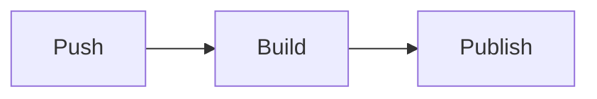

# Markdown Features

This page shows every Markdown feature document2 renders, followed by GitHub syntax it does not render yet.

- [Headings](#headings)
- [Text](#text)
- [Lists](#lists)
- [Tables](#tables)
- [Blockquotes](#blockquotes)
- [Links and Images](#links-and-images)
- [Attributes](#attributes)
- [Not Rendered Yet](#not-rendered-yet)

<a name="headings"></a>
## Headings

### Heading level 3

#### Heading level 4

##### Heading level 5

###### Heading level 6

A paragraph directly below a heading. Paragraphs are separated by a blank line, and a line break inside a paragraph
is joined into the same line.

A line ending with two spaces  
breaks here, and a line ending with a backslash\
breaks here too.

<a name="text"></a>
## Text

Text can be **bold**, _italic_, ***bold and italic***, ~~struck through~~, or `inline code`.
Combine them: **bold with `code` inside** and _italic with a [link](https://laravel.com)_.

Special characters are escaped: \*not italic\*, 5 &lt; 10, and &copy; 2026.

---

The line above is a horizontal rule. So are the next two.

***

___

<a name="lists"></a>
## Lists

Unordered list:

- Apples
- Oranges
    - Navel
    - Blood
        - Moro
        - Tarocco
- Bananas

Ordered list:

1. Install the package.
2. Publish the configuration.
    1. Run `php artisan vendor:publish`.
    2. Edit `config/example.php`.
3. Clear the cache.

An ordered list that starts at 5:

5. Fifth
6. Sixth

Task list:

- [x] Write the documentation
- [x] Add code samples
- [ ] Review the design
    - [ ] Light mode
    - [ ] Dark mode

A list with paragraphs and code:

1. First step.

   This paragraph belongs to the first step.

   ```bash
   php artisan about
   ```

2. Second step.

<a name="tables"></a>
## Tables

| Left aligned | Centered | Right aligned |
| :----------- | :------: | ------------: |
| `string`     | yes      | 1             |
| `integer`    | no       | 1,024         |
| `boolean`    | yes      | 65,536        |

A wide table:

| Method | URI | Action | Middleware | Name | Description |
| ------ | --- | ------ | ---------- | ---- | ----------- |
| GET | `/projects` | `ProjectList` | `auth` | `projects.index` | Lists the projects of the signed-in author with their latest build status. |
| GET | `/projects/create` | `AddProject` | `auth` | `projects.create` | Registers a repository as a new project and starts the first build. |
| GET | `/projects/{project}/settings` | `ProjectSettings` | `auth` | `projects.settings` | Changes the versions, default document, project name, and custom domain. |

A table with formatting inside cells:

| Feature | Status |
| ------- | ------ |
| **Search** | ~~Planned~~ Done |
| _Versions_ | Supported, see [Installation](/docs/{{version}}/installation) |

<a name="blockquotes"></a>
## Blockquotes

> A blockquote with **bold** text and a [link](https://example.com).

> A blockquote with several paragraphs.
>
> The second paragraph.
>
> > A nested blockquote.

> A blockquote with a list:
>
> - One
> - Two

<a name="links-and-images"></a>
## Links and Images

- An inline link: [Laravel](https://laravel.com)
- A link with a title: [Laravel](https://laravel.com "The PHP framework")
- A link to another page in this version: [Configuration](/docs/{{version}}/configuration)
- A link to a section on this page: [Tables](#tables)
- A reference link: [CommonMark][commonmark]
- An autolink: https://github.com/replworks-bot/document2-test-docs
- An angle-bracket autolink: <https://commonmark.org>
- An email autolink: <hello@example.com>

[commonmark]: https://spec.commonmark.org "CommonMark Spec"

An image:


A linked image:

[](https://github.com/replworks-bot)

<a name="attributes"></a>
## Attributes

A paragraph with a class and an id.
{.lead #intro}

A link with a class: [Get started](/docs/{{version}}/installation){.button}

<a name="not-rendered-yet"></a>
## Not Rendered Yet

GitHub renders the syntax below, but document2 does not have the extensions for it yet.
It shows how each one appears today.

### Alerts

> [!NOTE]
> Useful information that users should know.

> [!TIP]
> Helpful advice for doing things better.

> [!IMPORTANT]
> Key information users need to know.

> [!WARNING]
> Urgent info that needs immediate attention.

> [!CAUTION]
> Advises about risks or negative outcomes.

### Footnotes

Here is a sentence with a footnote.[^1]

[^1]: This is the footnote text.

### Mermaid



### Math

Inline math $E = mc^2$ and a block:

$$
\sum_{i=1}^{n} i = \frac{n(n+1)}{2}
$$

### Emoji shortcodes

:rocket: :tada: :+1:

### Collapsed section

<details>
<summary>Click to expand</summary>

Hidden content.

</details>

### Keyboard keys

Press <kbd>Ctrl</kbd> + <kbd>C</kbd> to copy.
